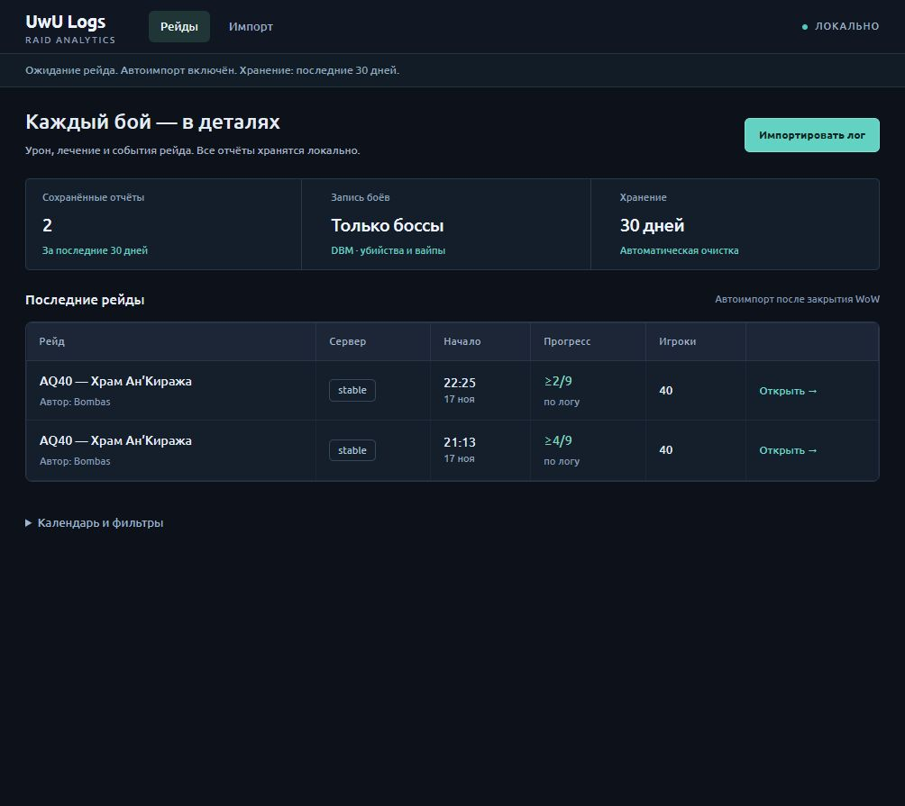
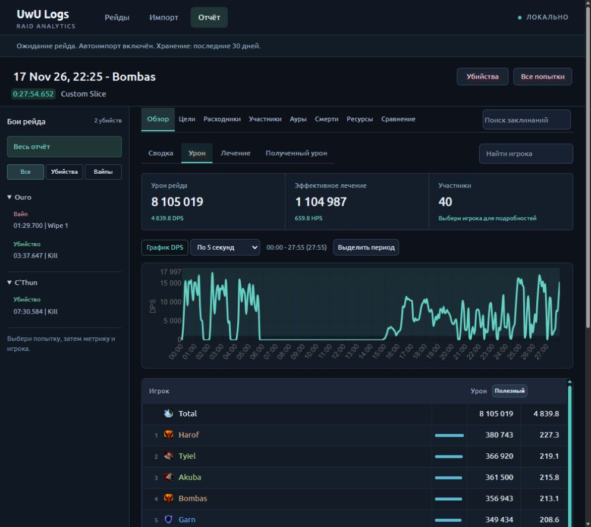
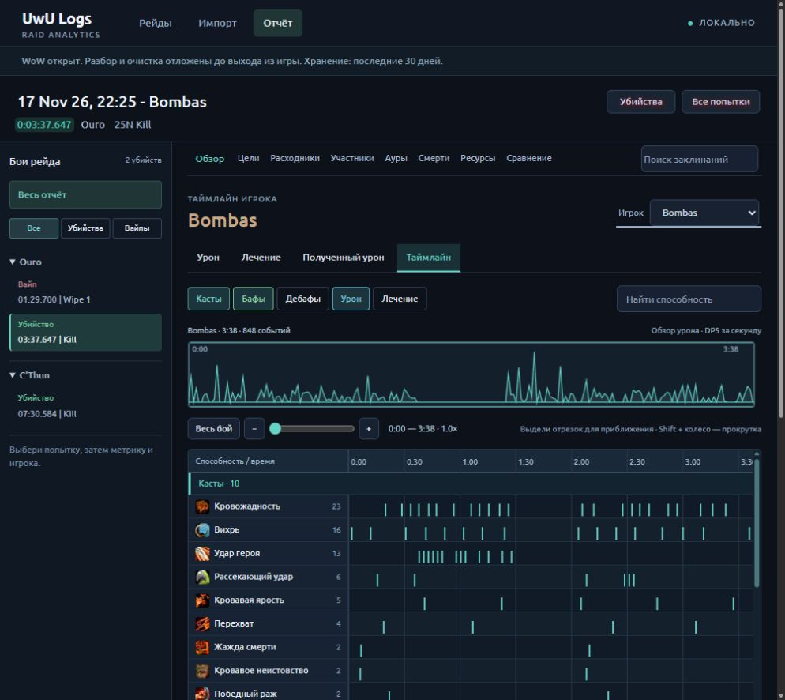
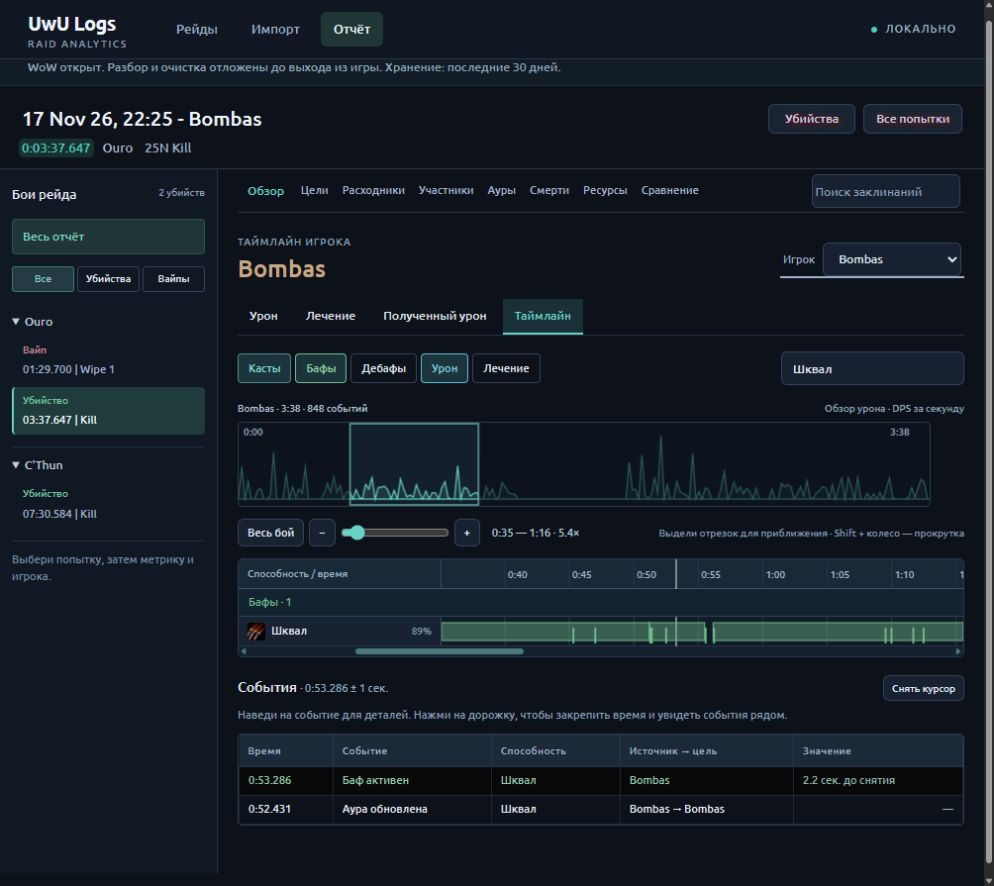
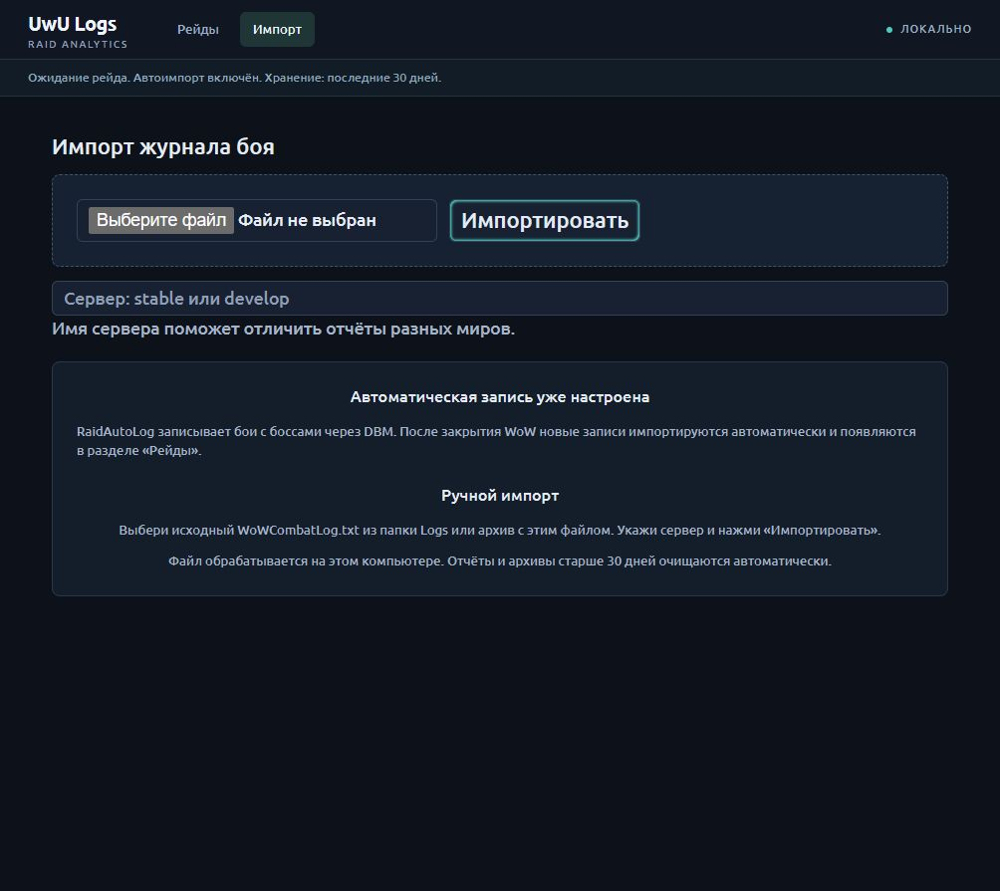

# UwU Logs

## Updated design

A local raid analytics interface for WoW 3.3.5a with encounter navigation, metric tabs, player search and a visible DPS graph: a raid library, damage and
healing summaries, readable player tables, and a simple combat-log import flow.

### Raid library

Recent reports show the raid name, author, server, start time and player count.



### Raid report

Damage, effective healing and participants at a glance, with controls for
switching damage and healing views and opening individual player details.



### Player timeline

The timeline separates casts, buffs, debuffs, outgoing damage and healing into
switchable tracks. Select a range in the DPS overview or drag across a track
to zoom in; use the horizontal scrollbar or Shift + wheel to move through time.
Spell labels and the time ruler stay visible while scrolling.



Search for an ability, hover events for details, or click to pin a shared time
cursor. The event table shows nearby casts/hits and buffs active at that time.
Arrow keys move the cursor; Escape or **Весь бой** restores the full encounter.
Buffs whose application is absent from the log have dashed spans and an
approximate uptime marker. Auras with no recorded events cannot be recovered.



### Combat-log import

Automatic recording uses DBM boss encounters. Import and 30-day cleanup run
after WoW closes; manual import is also available.



---

<https://uwu-logs.xyz/>

UwU Logs is a World of Warcraft combat log parser.

Supports any Wrath of the Lich King (3.3.5) server.

❤️ Inspired by World of Logs, LegacyPlayers and Warcraft Logs.

## Local raid analytics fork

This fork adds a responsive dark UI, a recent-raid library, report summaries,
readable damage/healing tables, and visible report navigation. The existing
parser and encounter calculations remain in place.

### Local Windows installation

Place this repository in a subfolder of your WoW 3.3.5a installation.
Create a Python 3.12 virtual environment named `.venv`, then install
`requirements-local.txt`. Copy `auto-config.example.json` to `auto-config.json`
and set your client log path, timezone and realm-address mapping.

Run `python -X utf8 local_server.py` and visit `http://127.0.0.1:5000/`.
Only the loopback interface is bound. Import accepts the raw `WoWCombatLog.txt`
as well as archives; the original upstream 7-Zip executable and `7z.dll` are
needed for archive parsing. Download the optional icon pack linked below.

Copy `addon/RaidAutoLog` to your client's `Interface/AddOns` directory. It uses
DBM-Core pull/kill/wipe callbacks to record only raid boss encounters.
By default, automatic import, calendar indexing, journal rotation and 30-day
retention run only after WoW closes. Files held open by WoW are never rotated.
Logs, local config, downloaded runtimes and personal state are not committed.

## Self hosting

- Install packages from `requirements.txt`

- Run `python Z_SERVER.py` OR `gunicorn3 Z_SERVER:SERVER --port 5000 -D`

- Visit <http://localhost:5000/>

#### Optional
##### Top

- Run `python server_top.py` OR `uvicorn server_top:app --port 5020 --proxy-headers`

##### File uploads

- Run `python server_upload.py` OR `uvicorn server_upload:app --port 5010 --proxy-headers`

##### Download spells/classes icons pack

- [Google Drive download](https://drive.google.com/file/d/17DyiCJts01CkFIkd0-G1dVAypIlxd0pP)

- Extract to root folder.

## Showcase

### Top

<https://uwu-logs.xyz/top>


### PvE Statistics

<https://uwu-logs.xyz/top_stats>


### Player total and per target spell info


### Damage to targets + useful


### Player comparison


### Spell search and overall info


### Consumables


## TODO

- friendly fire: Bloodbolt Splash, ucm, vortex
- self harm: ucm, Chilled to the Bone
- site side logs parser - filter forms - guid spell etc

- portal stacks
- valk grabs + necrotic + defile targets

- fix unlogical buff duration max 30 sec? last combat log entry? filter out long spells - ff hmark
- if buff not in long_buffs check top50% avg of this buff

- add summary stats like max hit done max hit taken max absorb max grabs
- 1 tick total - all targets dmg from 1 hurricane tick or typhoon

## Raid progress

The raid library shows boss progress and a readable start date. RaidAutoLog
records instance progress from the server lock prompt (and extended saved-raid
API when the server supports it), including bosses killed before you joined.
Its saved variables are read locally after logout. Reload the client after
installing or updating the addon.

A partial combat log cannot reveal earlier boss kills. Reports without an
instance snapshot show a lower bound such as `≥2/9` with a “from log” hint;
this is not presented as the complete lockout progress. Servers that do not
provide encounter progress retain this lower-bound display.

## Automatic remote export

Set `remote_export_url` in the private `auto-config.json` to a UwU Logs server
URL. Completed archives, including older imports, are uploaded after WoW
closes. The original server label and timezone are preserved. Reports are
checked on the destination before an archive is marked as exported.

Failed exports remain queued; retry state survives restarts. A destination
disk-space error delays retries for one hour. Local logs are retained under
the normal retention policy. Export checkpoints are private and ignored by Git.

Set `reports_url` to open reports on that server by default. The launcher opens
its raid library, and local home/library/report URLs redirect there while
preserving the report path and encounter query. Upload and maintenance endpoints
continue running locally. When `reports_url` is empty, `remote_export_url` is
used as the preferred viewer if configured.

## One report per raid lockout

Update `addon/RaidAutoLog/Progress.lua` in the game client and reload the UI.
The addon records the actual instance save ID and difficulty using the classic
saved-instance API. Automatic archives carry a small `uwu-lockouts.json`
manifest. The client and destination server both need this version of the code.

When the save ID matches, pauses, roster changes and client restarts append
to the same report. Different save IDs, difficulties or reset periods remain
separate. Without a reliable save ID, the importer keeps its legacy separation
instead of guessing that two runs share a lockout. Overlapping captures are
deduplicated without removing legitimate identical hits in the same timestamp.

To combine existing reports known to share a lockout, stop the viewer and run
the following **inside the project folder**, then restart the viewer:

```sh
python merge_raid.py REPORT_ID_1 REPORT_ID_2 REPORT_ID_3
```

The oldest report ID becomes canonical. Original report folders and the old
index are kept in `.raid-merge-backups`; old links redirect to the combined
report. The report defaults to boss segments so overnight pauses do not dilute
DPS/HPS. Merge backups follow the configured report retention period.
